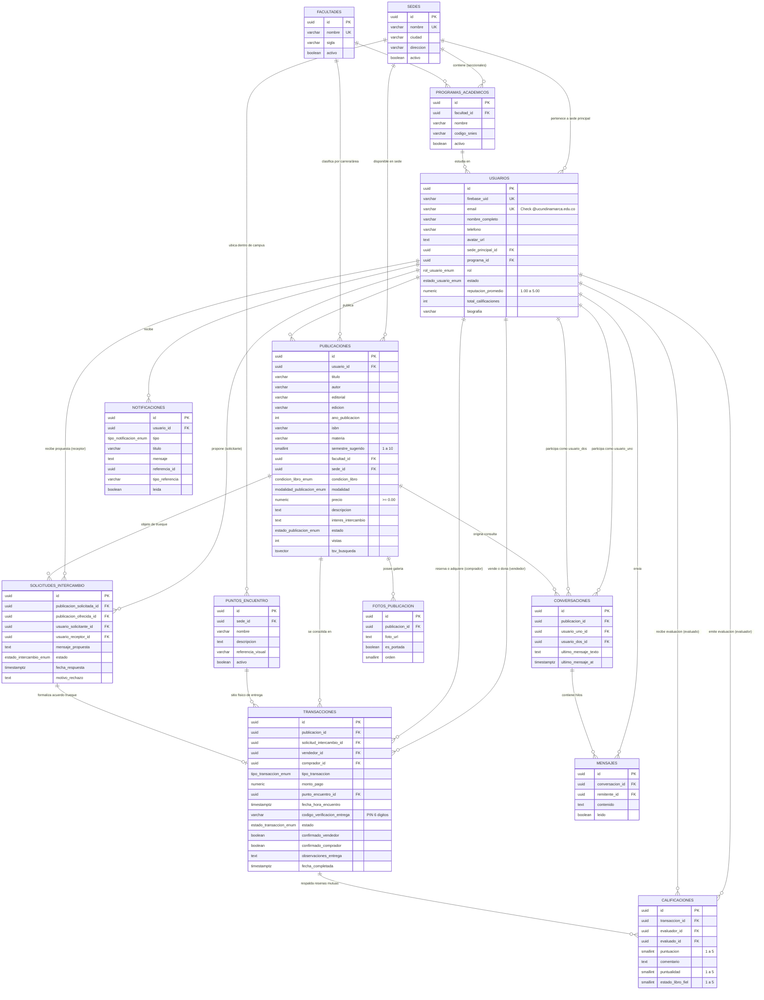

# ARQUITECTURA DE SOFTWARE Y MODELO DE DATOS
## Proyecto de Grado: "Unibooks: Plataforma para compra, venta e intercambio de libros para la Universidad de Cundinamarca"

---

## 1. Visión General de la Arquitectura del Sistema

**Unibooks** implementa una arquitectura multicapa desacoplada y orientada a servicios (API RESTful), orientada a garantizar alta disponibilidad, seguridad, escalabilidad y facilidad de mantenimiento.

```
+---------------------------------------------------------------------------------------+
|                                    CAPA DE CLIENTES                                   |
|   +------------------------------------+    +-------------------------------------+   |
|   |    Flutter Móvil (Android APK)     |    |         Flutter Web Client          |   |
|   |    (Clean Architecture + BLoC)     |    |     (Firebase Hosting / CDN)        |   |
|   +-----------------+------------------+    +------------------+------------------+   |
+---------------------|------------------------------------------|----------------------+
                      |                                          |
                      | HTTPS / JSON (REST API)                  |
                      v                                          v
+---------------------------------------------------------------------------------------+
|                                  CAPA DE SERVICIOS (BACKEND)                           |
|   +-------------------------------------------------------------------------------+   |
|   |                        FastAPI (Python 3.11+) en Render / Cloud Run           |   |
|   |  - Autenticación: Middleware JWT Firebase Admin SDK (@ucundinamarca.edu.co)   |   |
|   |  - Documentación Interactiva: OpenAPI / Swagger UI                            |   |
|   |  - Lógica de Dominio: Catálogo, Trueques, Reservas, Calificaciones, Chat     |   |
|   |  - Capa de Acceso a Datos: SQLAlchemy 2.0 (Async/Sync) + Pydantic V2         |   |
|   +---------------------------------------+---------------------------------------+   |
+-------------------------------------------|-------------------------------------------+
                                            |
         +----------------------------------+----------------------------------+
         |                                  |                                  |
         v                                  v                                  v
+-----------------------+  +--------------------------------+  +-------------------------------+
|     BASE DE DATOS     |  |       SERVICIOS CLOUD          |  |     MÓDULO DE ANALÍTICA       |
| PostgreSQL (Supabase) |  |   Firebase Authentication      |  | Dashboard Streamlit (Python)  |
| - DDL Normalizado 3NF |  |   (Tokens JWT + Validación)    |  | - EDA de Oferta y Demanda     |
| - Triggers Reputación |  |   Firebase Storage             |  | - Métricas por Facultad/Sede  |
| - Full Text Search    |  |   (Almacenamiento de Fotos)    |  | - Plotly / Pandas Visuals     |
+-----------------------+  +--------------------------------+  +-------------------------------+
```

---

## 2. Diagrama Entidad-Relación (DER) - Notación Mermaid

A continuación se detalla el modelo entidad-relación en 3ra Forma Normal (3NF):



---

## 3. Diccionario de Datos Formal

### 3.1. Entidades Maestras
| Tabla | Campo | Tipo | Nulable | Restricción / FK | Descripción |
| :--- | :--- | :--- | :--- | :--- | :--- |
| `sedes` | `id` | UUID | NO | PK DEFAULT `gen_random_uuid()` | Identificador universal único de la sede. |
| | `nombre` | VARCHAR(100) | NO | UNIQUE | Nombre oficial (Fusagasugá, Girardot, Ubaté, etc.). |
| | `ciudad` | VARCHAR(100) | NO | | Municipio donde opera el campus. |
| | `direccion`| VARCHAR(255) | NO | | Dirección física institucional. |
| | `activo` | BOOLEAN | NO | DEFAULT `TRUE` | Estado operativo de la sede. |
| `facultades` | `id` | UUID | NO | PK DEFAULT `gen_random_uuid()` | Identificador de la facultad. |
| | `nombre` | VARCHAR(150) | NO | UNIQUE | Nombre formal de la facultad en la UDEC. |
| | `sigla` | VARCHAR(20) | SI | | Acrónimo (ej. FING, FCAEC). |
| `puntos_encuentro`| `id`| UUID | NO | PK DEFAULT `gen_random_uuid()` | Identificador del punto seguro. |
| | `sede_id` | UUID | NO | FK `sedes(id)` ON RESTRICT | Sede universitaria donde se encuentra. |
| | `nombre` | VARCHAR(120) | NO | | Ej. "Biblioteca Central - Entrada Principal". |
| | `descripcion`| TEXT | NO | | Descripción con iluminación y seguridad. |

### 3.2. Gestión de Usuarios y Seguridad
| Tabla | Campo | Tipo | Nulable | Restricción / FK | Descripción |
| :--- | :--- | :--- | :--- | :--- | :--- |
| `usuarios` | `id` | UUID | NO | PK DEFAULT `gen_random_uuid()` | Identificador interno relacional. |
| | `firebase_uid` | VARCHAR(128) | NO | UNIQUE | UID emitido por Firebase Auth. |
| | `email` | VARCHAR(150) | NO | UNIQUE + CHECK (`@ucundinamarca.edu.co`) | Correo institucional verificado. |
| | `nombre_completo`| VARCHAR(150)| NO | | Nombres y apellidos del estudiante/docente. |
| | `rol` | ENUM | NO | `ESTUDIANTE`, `DOCENTE`, `ADMIN` | Rol asignado para permisos y auditoría. |
| | `reputacion_promedio`| NUMERIC(3,2)| NO| CHECK (`1.00` a `5.00`) | Calculado por trigger tras cada reseña. |
| | `total_calificaciones`| INT | NO | DEFAULT `0` | Conteo de opiniones recibidas. |

### 3.3. Transacciones, Intercambios y Reputación
| Tabla | Campo | Tipo | Nulable | Restricción / FK | Descripción |
| :--- | :--- | :--- | :--- | :--- | :--- |
| `publicaciones` | `modalidad` | ENUM | NO | `VENTA`, `INTERCAMBIO`, `VENTA_O_INTERCAMBIO`, `DONACION` | Modelo de traspaso del ejemplar. |
| | `precio` | NUMERIC(10,2)| NO | CHECK (`precio >= 0.00`) | Costo en COP (0 para trueque/donación). |
| `solicitudes_intercambio` | `estado`| ENUM | NO | `PENDIENTE`, `ACEPTADA`, `RECHAZADA`, `COMPLETADA` | Ciclo de vida de la propuesta libro x libro. |
| `transacciones` | `codigo_verificacion_entrega` | VARCHAR(6) | NO | Alfanumérico | PIN de validación en punto de encuentro. |
| | `estado` | ENUM | NO | `PENDIENTE_ENCUENTRO`, `COMPLETADA`, `CANCELADA` | Estado del intercambio/compra física. |
| `calificaciones` | `puntuacion` | SMALLINT | NO | CHECK (`1` a `5`) | Escala Likert de satisfacción. |

---

## 4. Reglas de Negocio Implementadas a Nivel de Base de Datos

1. **Restricción Institucional UDEC:**
   - La tabla `usuarios` incluye un `CHECK (email ~* '^[A-Za-z0-9._%+-]+@ucundinamarca\.edu\.co$')` que garantiza integridad a nivel de persistencia.
2. **Cálculo Automático de Reputación:**
   - Mediante el trigger `trg_actualizar_reputacion_usuario` en la tabla `calificaciones`, el promedio ponderado y la cantidad de reseñas del usuario calificado se actualizan de forma atómica y sin riesgo de inconsistencia concurrente.
3. **Búsqueda Avanzada en Español (Full-Text Search):**
   - La tabla `publicaciones` contiene un campo vectorial indexado por GIN (`tsv_busqueda`) con ponderación semántica:
     - Peso A: Título del libro.
     - Peso B: Autor.
     - Peso C: Asignatura / Materia universitaria.
     - Peso D: Editorial y Descripción.
   - Utiliza el diccionario en español y la extensión `unaccent` para ignorar tildes en búsquedas (ej. "calculo" encuentra "Cálculo").
4. **Puntos de Encuentro Seguros:**
   - Cada transacción exige asociar un `punto_encuentro_id` pre-aprobado dentro de la sede física de la universidad, eliminando riesgos de seguridad para los estudiantes.
5. **Código de Verificación Antifraude:**
   - La transacción genera un token/PIN de 6 dígitos que ambas partes validan en el campus para marcar la transacción como `COMPLETADA`.
