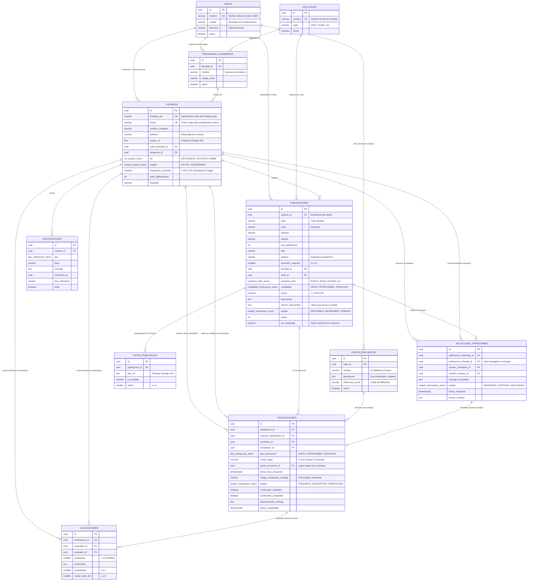

# MODELADO DE DATOS HÍBRIDO (POSTGRESQL + FIREBASE FIRESTORE)
## Proyecto de Grado: "Unibooks: Plataforma para compra, venta e intercambio de libros para la Universidad de Cundinamarca"

---

## 1. Visión de la Arquitectura de Datos Híbrida

Para responder con máxima eficiencia a los requisitos académicos y de escalabilidad, Unibooks implementa una **Arquitectura de Persistencia Políglota (Híbrida)**:

```
+---------------------------------------------------------------------------------------+
|                                      CAPA DE DATOS                                    |
|   +------------------------------------+    +-------------------------------------+   |
|   |   BASE DE DATOS RELACIONAL (RDBMS) |    |      MOTOR EN TIEMPO REAL (NoSQL)   |   |
|   |         PostgreSQL (Supabase)      |    |          Firebase Firestore         |   |
|   |  - Catálogo de Libros (CRUD)       |    |  - Mensajería Directa (WhatsApp)    |   |
|   |  - Búsqueda Full-Text con unaccent |    |  - Streams de Mensajes de Texto     |   |
|   |  - Sedes, Carreras y Campus UDEC   |    |  - Fotos instantáneas en Chat       |   |
|   |  - Transacciones y PIN de Entrega  |    |  - Estado de lectura y presencia    |   |
|   |  - Triggers de Reputación Promedio |    |  - Seguridad por Reglas Firestore   |   |
|   +------------------------------------+    +-------------------------------------+   |
|                                                                                       |
|   +-------------------------------------------------------------------------------+   |
|   |                     ALMACENAMIENTO MULTIMEDIA (OBJECT STORAGE)                |   |
|   |                               Firebase Storage                                |   |
|   |  - Fotos de Perfil (Avatares de Estudiantes)                                  |   |
|   |  - Galería de Fotos de Libros (1 a 4 imágenes de portada y estado físico)     |   |
|   |  - Fotografías enviadas a través de la conversación en tiempo real            |   |
|   +-------------------------------------------------------------------------------+   |
+---------------------------------------------------------------------------------------+
```

---

## 2. Diagrama Entidad-Relación (DER) Relacional - Notación Mermaid

El siguiente diagrama formaliza el modelo relacional implementado en PostgreSQL para el Backend FastAPI:



---

## 3. Esquema NoSQL en Firebase Firestore (Motor de Chat en Tiempo Real)

Para lograr la experiencia interactiva estilo WhatsApp con actualización instantánea (<100ms) y compartición de fotos, se diseñó la siguiente jerarquía de colecciones en Firestore:

### 3.1. Colección `/chats/{chatId}`
* **Identificador de documento (`chatId`):** Generado de forma determinista para evitar conversaciones duplicadas:
  `{publicacionId}_{compradorUid}_{vendedorUid}`
* **Estructura del Documento:**
```json
{
  "chatId": "66666666-6666-6666-6666-666666666601_carlos_maria",
  "publicacionId": "66666666-6666-6666-6666-666666666601",
  "tituloLibro": "Cálculo: Trascendentes Tempranas",
  "portadaLibroUrl": "https://firebasestorage.googleapis.com/.../calculo.jpg",
  "precioLibro": 65000.0,
  "modalidadLibro": "VENTA_O_INTERCAMBIO",
  "participantes": ["fb_uid_carlos_02", "fb_uid_maria_03"],
  "compradorUid": "fb_uid_maria_03",
  "vendedorUid": "fb_uid_carlos_02",
  "compradorNombre": "María Paula Rodríguez",
  "vendedorNombre": "Carlos Mendoza Vargas",
  "compradorAvatarUrl": "https://firebasestorage.googleapis.com/.../maria.jpg",
  "vendedorAvatarUrl": "https://firebasestorage.googleapis.com/.../carlos.jpg",
  "ultimoMensajeTexto": "¿Podrías enviarme una foto de la tabla de integrales?",
  "ultimoMensajeTipo": "TEXT",
  "ultimoMensajeTimestamp": "2026-10-15T12:00:00Z",
  "ultimoMensajeRemitenteUid": "fb_uid_maria_03",
  "noLeidosPorUsuario": {
    "fb_uid_carlos_02": 1,
    "fb_uid_maria_03": 0
  },
  "creadoEn": "2026-10-15T11:45:00Z",
  "activo": true
}
```

### 3.2. Subcolección `/chats/{chatId}/messages/{messageId}`
Cada mensaje enviado se registra como un documento inmutable dentro de la subcolección del chat:
```json
{
  "messageId": "msg_uuid_0001",
  "remitenteUid": "fb_uid_carlos_02",
  "remitenteNombre": "Carlos Mendoza Vargas",
  "texto": "Claro que sí, mira cómo está la tabla de fórmulas:",
  "fotoUrl": "https://firebasestorage.googleapis.com/.../chats/msg_foto_01.jpg",
  "tipo": "IMAGE", // "TEXT" o "IMAGE"
  "timestamp": "2026-10-15T12:01:23Z",
  "leido": true
}
```

### 3.3. Índices Compuestos Requeridos en Firestore
* Colección `chats`: `participantes` (Array-contains) + `ultimoMensajeTimestamp` (Descending) para ordenar las conversaciones recientes en la bandeja de entrada.
* Subcolección `messages`: `timestamp` (Ascending) para renderizar el flujo cronológico de mensajes.

---

## 4. Estructura de Almacenamiento en Firebase Storage

```
gs://unibooks-udec.appspot.com/
├── avatars/
│   └── {userId}/
│       └── profile.jpg                 # Foto de perfil del estudiante
├── publications/
│   └── {publicationId}/
│       ├── photo_1.jpg                 # Foto de portada principal
│       ├── photo_2.jpg                 # Detalle de lomo o encuadernación
│       └── photo_3.jpg                 # Muestra de páginas interiores
└── chats/
    └── {chatId}/
        └── {imageUuid}.jpg             # Fotografías enviadas por el chat en vivo
```

---

## 5. Reglas de Seguridad Implementadas

1. **PostgreSQL:**
   * Restricción CHECK de correo: `chk_email_institucional CHECK (email ~* '^[A-Za-z0-9._%+-]+@ucundinamarca\.edu\.co$')`.
   * Restricción de calificación: `CHECK (puntuacion >= 1 AND puntuacion <= 5)`.
   * Trigger atómico `trg_actualizar_reputacion_usuario` para evitar inconsistencias en el cálculo de estrellas.
2. **Firestore (`database/firestore.rules`):**
   * Validación del token JWT de Firebase con expresión regular para el dominio `@ucundinamarca.edu.co`.
   * Verificación de pertenencia al array de `participantes` antes de permitir lectura o escritura de mensajes.
3. **Storage (`database/storage.rules`):**
   * Verificación de tipo MIME `image/*` y tamaño máximo de 5MB por imagen.
   * Escritura en la carpeta `/avatars/{userId}/` restringida estrictamente al propio usuario dueño del UID.
